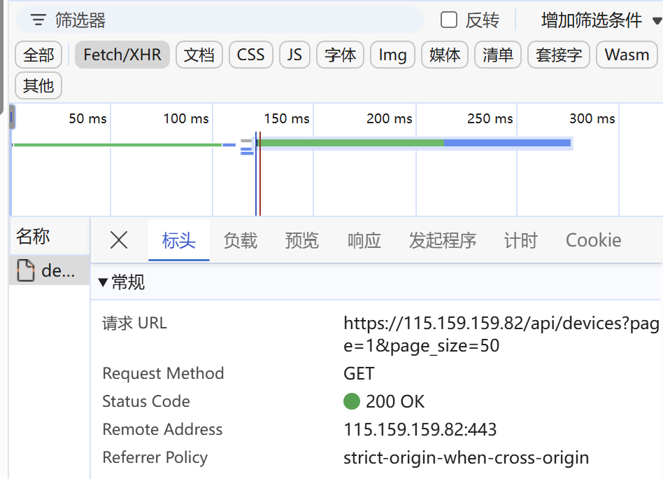
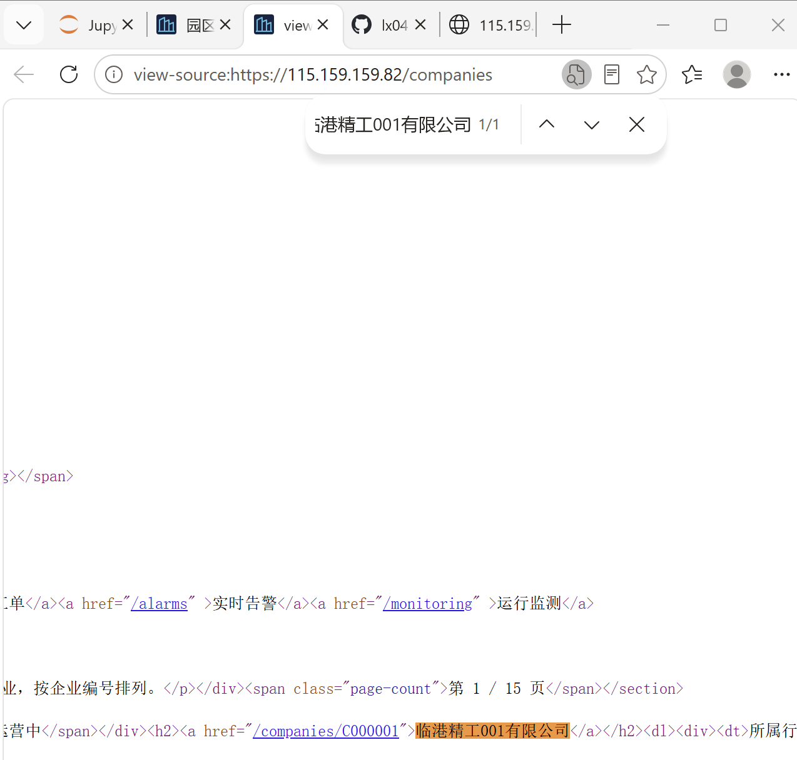
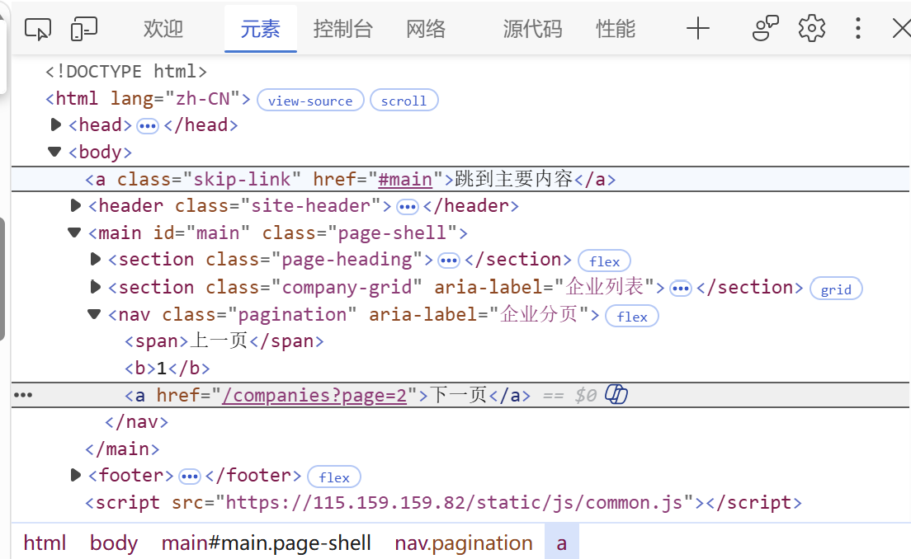
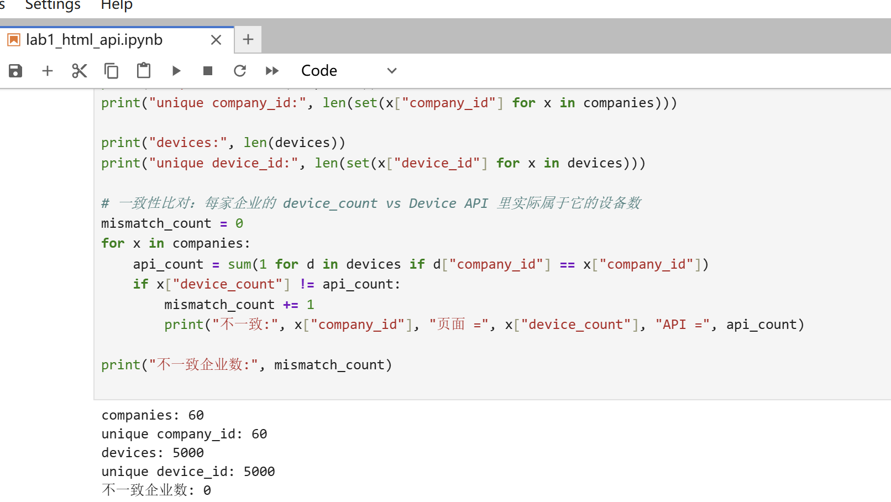

# Lab 1 实验报告

## 学生信息

- **姓名：** 鲁子蕊
- **学号：** 112404260110
- **班级：** 数据1241
- **GitHub 用户名：** lx0410-star
- **仓库地址：** https://github.com/lx0410-star/bigdata-collection-labs-112404260110

> 文件位置：`lab01/REPORT.md`  
> 完整代码保存在 `lab1_html_api.ipynb`。  
> 本报告只填写关键发现、关键代码、结果和指定截图，**不要把整份 Notebook 复制进来**。

---

# 任务 1：判断数据加载方式

## 1.1 Device：判断动态加载并找到 API

### 判断结果

- 页面：`/devices`
- 数据加载方式：`动态加载`
- 判断依据：在“查看网页源代码”中搜索页面上显示的设备名称（如第一行设备 `循环泵-000001-001`）**搜不到**，说明设备数据没有随初始 HTML 一起返回；随后在 `F12 → Network → Fetch/XHR` 中刷新页面，找到了真正返回设备列表的请求 `GET /api/devices?page=1&page_size=50`，其响应为 JSON，设备数据由该请求**动态加载**。

请用 1～2 句话说明：

1. 在“查看网页源代码”中是否能搜索到页面上的设备名称；
2. 在 Network 的 Fetch/XHR 中是否找到返回设备数据的请求。

### API 信息

- Request URL：https://115.159.159.82/api/devices?page=1&page_size=50
- Request Method：GET
- Query 参数：page=1 page_size=50

### 【截图 1】Device API 发现证据

文件名：

```text
images/01_device_api.png
```

**截图内容必须是浏览器 DevTools，不是 Jupyter 代码。**

截图中应能看清：

1. 浏览器的 **Network** 面板；
2. 已选中真正返回设备列表的 Fetch/XHR 请求；
3. 右侧 **Headers** 中的 Request URL；
4. Query String Parameters（或 URL 中的分页参数）。

> 不要截整个桌面；尽量裁剪到 Network 请求和右侧 Headers 区域。



---

## 1.2 Company：判断静态加载

- 页面：`/companies`
- 数据加载方式：`静态加载`
- 判断依据：使用“右键 → 查看网页源代码”打开 `/companies` 的源码后，按 `Ctrl + F` 搜索页面中真实显示的企业名称 `临港精工001有限公司`，**能搜到**（企业名称出现在源码的企业记录节点中），说明企业数据随初始 HTML 一起返回，不需要浏览器执行 JS 二次加载，因此按**静态页面**处理即可。

请说明：使用“右键 → 查看网页源代码”后，是否能搜索到页面中真实显示的企业名称。

### 【截图 2】Company 静态加载证据

文件名：

```text
images/02_company_source.png
```

**截图内容必须是“查看网页源代码”页面，不是 Elements，也不是 Jupyter。**

截图中应能看清：

1. 浏览器正在显示 `/companies` 的网页源代码；
2. 使用 `Ctrl + F` 搜索一个页面中真实存在的企业名称；
3. 源代码中能看到该企业名称或对应企业记录。



---

# 任务 2：Device API 分页采集

## 2.1 API 分页结构

填写你实际从 JSON 中观察到的字段：

| 含义 | JSON 字段 |
|---|---|
| 当前页 |`page` |
| 每页条数 | `page_size` |
| 设备总数 |`total` |
| 设备列表 | `items` |

---

## 2.2 关键代码

只填写分页采集的核心部分，不要粘贴整个 Notebook。

```python
# 从第一页响应中读取分页信息
total = data["total"]
page_size = data["page_size"]

total_pages = (total + page_size - 1) // page_size

devices = []

for page in range(1, total_pages + 1):
    r = requests.get(
        api_url,
        params={
            "page": page,
            "page_size": page_size
        },
        timeout=10
    )

    page_data = r.json()
    page_items = page_data["items"]
    devices.extend(page_items)
```

---

## 2.3 采集结果

- 每页条数：50
- 设备总数：5000
- 程序计算得到的总页数：100
- 最终采集设备数：5000
- 唯一 `device_id` 数：5000

回答：

> 为什么总页数应由 API 返回的 `total` 和 `page_size` 计算，而不是直接在代码里写死？

答：因为总页数取决于接口当前的数据量，只有运行时才知道。用 `(total + page_size - 1) // page_size` 现算，代码与具体数据量解耦：数据量变化时不用改代码，结果也始终正确。写死 `100` 则在数据量变化时直接出错——若 `total` 变成 5019，`100` 页只能取到 5000 条，最后 19 条会被漏掉；若数据量变少，又会多跑空请求。

---

# 任务 3：Company HTML 解析

## 3.1 企业记录 Selector

- 企业记录 selector：`article.company-card`
- 第 1 页企业记录数：`20`

说明为什么选择这个 selector：

- 主要使用了 `id / class / data-* / 父子层级` 中的哪一种？
- 是否参考过浏览器 Copy selector 或 AI？
- 最终为什么采用现在这个写法？

答：

- 该 selector 使用了 **class 选择器**（`company-card`），并叠加标签名 `article` 双重限定。
- 未使用浏览器 Elements 的 “Copy selector”。
- 选择 `article.company-card` 而不是 `section.company-grid`，是因为前者对应“一条企业记录”，后者对应“装载所有记录的容器”，只有前者能一次命中一页中的全部 20 条记录。

---

## 3.2 关键代码

只填写“记录定位 + 一条记录的关键字段”。

```python
cards = soup.select("article.company-card")

card = cards[0]

company_id = card.get("data-company-id")
name = card.select_one("h2 a").get_text(strip=True)
status = card.select_one("span.badge").get_text(strip=True)
```

行业、区域、设备数量使用 `dt/dd` 结构后，请写出你最终如何得到：

```python
industry     = details["所属行业"]
zone         = details["所在区域"]
device_count = int(details["设备数量"].replace("台", "").strip())
```

---

## 3.3 字段来源说明

任选 **2 个字段**说明：

1. 字段：company_id
   - 来自：`HTML 属性`
   - 使用的方法：company_id 不在卡片可见文本里，而是以 data-company-id 属性挂在
     <article> 记录节点上，用 card.get("data-company-id") 直接读取属性值。

2. 字段：device_count
   - 来自：`文本`
   - 使用的方法：先用 card.select("dl > div") 逐行配对 dt（字段名）与 dd（值），
     get_text(strip=True) 提取文本得到 "6 台"；再 replace("台", "") 去单位、
     strip() 去空格、int() 转成整数 6。

---

# 任务 4：Company “下一页”分页

## 4.1 下一页元素

- “下一页” selector：`nav.pagination a:last-child`
- 第 1 页 `href` 示例：`/companies?page=2`（相对路径，只有路径与查询参数，没有域名）

### 【截图 3】Company “下一页”元素

文件名：

```text
images/03_company_next.png
```

**截图内容必须是浏览器 DevTools 的 Elements 面板。**

截图中应能看清：

1. 页面底部“下一页”对应的 `<a>` 元素被选中；
2. 该元素的 `class`、`href` 等关键属性；
3. 能判断你为什么使用当前 selector。

> 不需要截 Python 代码；这一张图只证明你找到了正确的 DOM 元素。



---

## 4.2 关键代码

```python
next_link = soup.select_one("nav.pagination a:last-child")

next_href = next_link.get("href")

next_url = urljoin(
    current_url,
    next_href
)
```

再用 2～3 句话说明：

> 你的程序如何完成“当前页 → 找下一页 href → 请求下一页 → 再解析”的循环？

答：从第 1 页地址出发，每轮先请求当前页并解析出全部企业卡片（extend 逐条装入列表），再找“下一页”链接；若找不到（最后一页没有“下一页”）就 break 结束，避免对 None 取属性而报错；否则用 urljoin(当前页地址, href) 把相对路径拼成完整 URL，作为下一轮的请求地址。循环 3 次即采集第 1~3 页。

---

## 4.3 三页采集结果

| 页码 | 企业数 |
|---|---:|
| 1 |20
| 2 |20
| 3 |20
| **合计** |60

- 唯一 `company_id` 数：60

---

# 任务 5：结果验证

## 5.1 最终结果

| 检查项 | 结果 |
|---|---:|
| Company 总数 |60
| 唯一 `company_id` |60
| Device 总数 |5000
| 唯一 `device_id` | 5000
| Company–Device 不一致企业数 | 0

### 【截图 4】最终验证结果

文件名：

```text
images/04_validation.png
```

**截图内容必须是 JupyterLab 的运行结果，不是代码截图，也不是浏览器截图。**

截图中应能同时看清以下输出：

```text
Company 总数
唯一 company_id 数
Device 总数
唯一 device_id 数
Company–Device 不一致企业数
```

建议把这几个 `print()` 放在同一个 Notebook 单元格中运行后截图。



---

## 5.2 一致性检查关键代码

只填写最关键的比较逻辑：

```python
from collections import Counter

device_counts = Counter(
    x["company_id"] for x in devices
)

mismatch_count = 0

for company in companies:
    cid = company["company_id"]
    expected = device_counts[cid]
    actual = company["device_count"]

    if expected != actual:
        mismatch_count += 1
```

回答：

> 为什么 `status_code == 200` 仍然不能说明“数据已经采集正确”？

答：200 只代表服务器成功响应了请求，不保证内容正确。数据可能漏页（少请求了几页）、可能重复（同一页采了两遍导致 ID 重复）、可能字段错位或数量不符，这些问题状态码完全反映不出来。所以必须额外验证：总量是否符合、ID 是否唯一，并用 Device 数据反向统计各企业设备数，与 Company 页面的 device_count 交叉比对，全部一致才算采集正确。

---

# 任务 6：保存采集结果

确认已经生成：

```text
data/companies.json
data/devices.json
```

填写：

- `companies.json`：`已生成`
- `devices.json`：`已生成`

不需要截图 JSON 全文，也不需要把 JSON 内容复制到报告。

---

# 实验结论

用 **80～150 字**总结：

1. 静态加载与动态加载页面的处理方式有什么不同；
2. HTML “下一页”分页和 API `page` 分页有什么不同；
3. 你使用了哪些方法验证采集结果。

答：静态页面数据随 HTML 一起返回，用 requests 取文本、BeautifulSoup 加 CSS 选择器解析即可；动态页面数据由 JS 二次请求加载，须先在 Network 找到接口，改为请求 JSON 并按 page 翻页，总页数由 total 和 page_size 算出而非写死。HTML 分页只能顺次解析当前页再取下一页链接；API 分页可按页码取任意一页。验证时除状态码外，还核对了总量、ID 唯一性，并用 Device 统计数与企业页 device_count 交叉比对。

