# 实验二报告：房源采集与 MySQL 存储

- 班级：数据1241
- 姓名：鲁子蕊
- 学号：112404260110
- 实验日期：2026-10-27
- GitHub 仓库链接：https://github.com/lx0410-star/bigdata-collection-labs-112404260110
- 源码文件名：lab02/anjuke.ipynb（辅助文件 lab02/create_table.sql）
- 数据库与表：`smartpark_lab.houseinfo`
- 数据来源：在线教学站 http://www.bspider.top/anjuke/
- 访问时间及结果（若失败，填写状态码、页面标题或报错）：2026-11-6 访问，状态码 200，页面标题为「重庆二手房房产网，重庆二手房出售，重庆买房购房交易信息 - 58安居客」，返回 HTML 长度 280427，`div.property` 匹配 60 条，确认是房源列表而非验证页，因此继续在线采集，共 10 页。
- 快照文件来源与文件名（在线实验可写“不适用”）：不适用（在线采集成功，未使用网页快照）

> 填写要求：截图放在 `images/` 中，在对应位置插入图片。代码截图要显示文件名、行号或单元位置，用红框标出关键代码，每项写2—3句话解释。只截最终结果或只贴 AI 生成的文字，不能代替实验过程。未完成的项目写明原因，不填写预期结果，不展示个人账号密码。

## 第一阶段：MySQL Docker 更新与启动

- 本次是否需要更新：本次按更新包说明更新（L05 更新包，使用独立教学数据卷 `smartpark-student_l05-mysql-data`）
- 更新或启动遇到的问题：课程环境目录里原先是旧的数据卷，按更新包放入 `start-mysql.bat`、`mysql-console.bat`、`l05-mysql.ps1`、`l05-mysql-fresh-volume.yaml` 后，MySQL 改用新的 L05 教学卷启动，旧卷里建过的表在新卷中不存在，第一次查 `houseinfo` 报 `Table 'smartpark_lab.houseinfo' doesn't exist`。按手册要求没有删卷、没有改 `.env`，而是在新卷上用 `create_table.sql` 重新建表。另外首次拉取 `mysql:8.4.11` 镜像时 Docker Hub 连不通，改用国内镜像源拉取同一镜像后打成 `mysql:8.4.11` 标签，`l05-mysql.ps1` 的镜像 ID 校验通过。

### 启动环境与建表

依次使用 `start-course.bat`、`start-mysql.bat`、`mysql-console.bat` 启动课程环境、数据库和 MySQL 终端。

`start-mysql.bat` 输出 `[PASS] L05 MySQL healthy，账号连接检查通过。`，容器 `smartpark-student-mysql-1` 状态为 `Up (healthy)`。

**截图：** MySQL 启动成功提示，以及终端中 `USE smartpark_lab`、`SHOW TABLES`、`DESCRIBE houseinfo` 的执行结果。可分图。

> 截图来源：浏览器里的 JupyterLab 终端面板空白，所以把同样的 SQL 写进 Notebook 末尾「MySQL 终端取证」一节，用 `q()` 辅助函数调用工作区自带的 `mysql` 客户端（`-t` 表格输出、`utf8mb4` 编码）执行，输出与 `mysql>` 里的 `-t` 表格一致；命令回显里密码已打码为 `***`。

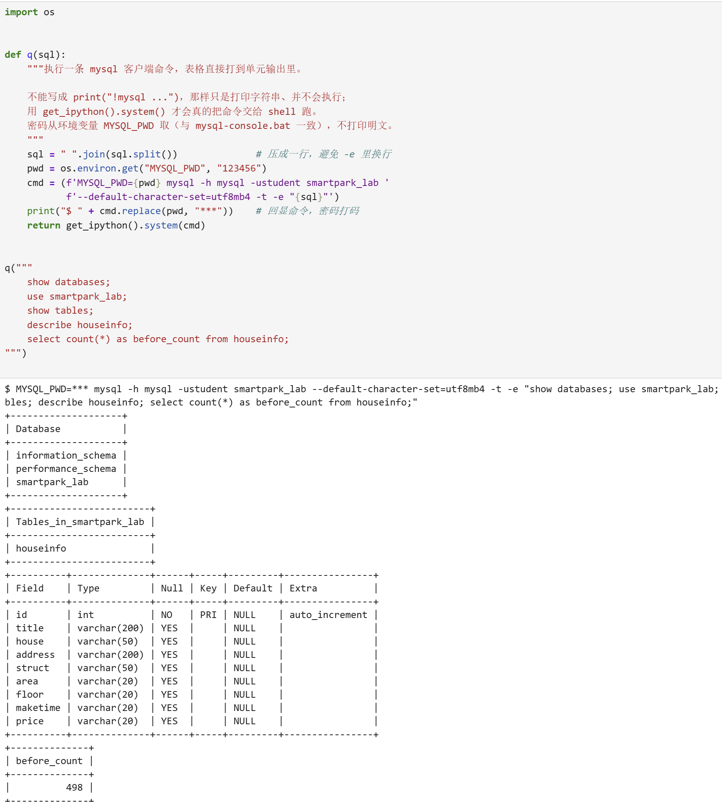

说明：当前使用哪个数据库？`id` 和8个房源字段分别保存什么？

答：当前使用 `smartpark_lab` 数据库，库中只有 `houseinfo` 一张表。

`id` 是 `INT AUTO_INCREMENT PRIMARY KEY`，由数据库自动生成，按插入顺序递增，不参与重复判断。其余 8 列都用 `VARCHAR` 保存采集到的原始文字：`title` 标题（卖点文案）、`house` 楼盘名、`address` 地址（多段 span 拼成的完整文字）、`struct` 户型（如 3室2厅1卫）、`area` 建筑面积（带 ㎡ 单位）、`floor` 楼层（如 低层(共27层)）、`maketime` 建造年代（如 2019年建造，缺失为空字符串）、`price` 每平方米单价（带 元/㎡ 单位，不是万元总价）。建表后第一次 `SELECT COUNT(*)` 为 0，这就是入库前条数；截图里的 `before_count` 是 498，因为该图是在三个阶段的流程全部跑完、数据已经入库后补拍的，它说明表结构正确、数据确实落到了这张表里，入库前后的条数变化见第三阶段的 `09_verify.png` 与 `12_mysql_after.png`。

## 第二阶段：房源采集与 CSV 数据存储

### 1. 网页分析与房源解析

#### 选择器是怎样得到的

在 Chrome 中按 F12，使用 **Elements → Copy → Copy selector**。选一个字段，记录从完整路径到相对选择器的过程。

（我本机浏览器里 JupyterLab 的终端面板是空白的，所以后面几处 MySQL 命令都不是在终端里敲的，而是在 Notebook 单元里调用工作区自带的 `mysql` 客户端执行同一批 SQL，见第十节 `q()` 函数。）

- 选择的字段：`title`（第一条房源的标题）
- 复制的原始选择器：`#__layout > div > section > section:nth-of-type(3) > section:nth-of-type(1) > section:nth-of-type(2) > div:nth-of-type(1) > a > div:nth-of-type(2) > div:nth-of-type(1) > div:nth-of-type(1) > h3`
- 一条房源的父容器选择器：`div.property`（它的完整路径是 `#__layout > div > section > section:nth-of-type(3) > section:nth-of-type(1) > section:nth-of-type(2) > div:nth-of-type(1)`，节点 `class="property"`）
- 最终使用的相对选择器：`h3.property-content-title-name`（在 `row` 内部 `select_one`）

**截图：** 框出该字段的 HTML 节点和房源父容器，展示选择器的匹配结果。

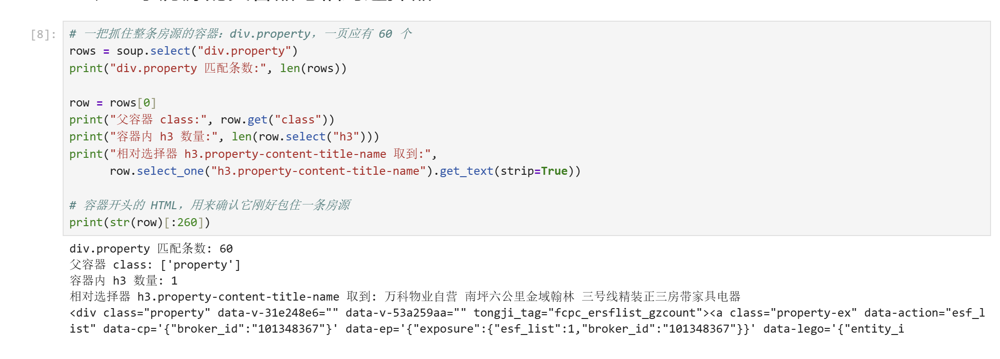

说明：删掉了哪些层级？怎样确认父容器刚好包含一条房源？

答：删掉了从 `#__layout` 到房源容器之间的全部祖先层级（页面布局、筛选区、列表区的多层 `section`/`div`），那些层级只是用来「走到」房源列表，和字段本身无关，页面结构一改就会失效。保留的思路是：先用 `div.property` 一次选中一条房源的父容器，再在容器内部用字段自己的 class 定位，这样选择器短且稳定。

确认父容器刚好包含一条房源的方法有三步：一是 `soup.select("div.property")` 返回 60 个节点，和页面每页 60 条房源一致；二是容器内 `h3` 的数量为 1，说明一条房源只有一个标题；三是打印容器开头的 HTML，能看到标题、地址、户型属性组、单价都在同一个 `div.property` 里。三条都对上，才把它当作「一条房源」来遍历。

#### 解析8个字段

**截图：** 自己编写的解析代码和首条房源的8个字段输出。代码中必须框出：

- `select()` 和 `select_one()`。
- 面积、单价的定位与取值。
- 建造年代的提取和缺失处理。

可分成几张局部截图。另附面积、单价对应的 HTML 节点或网页原文。

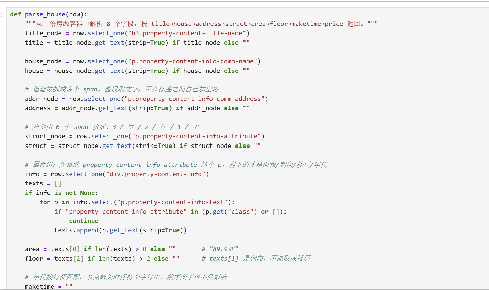

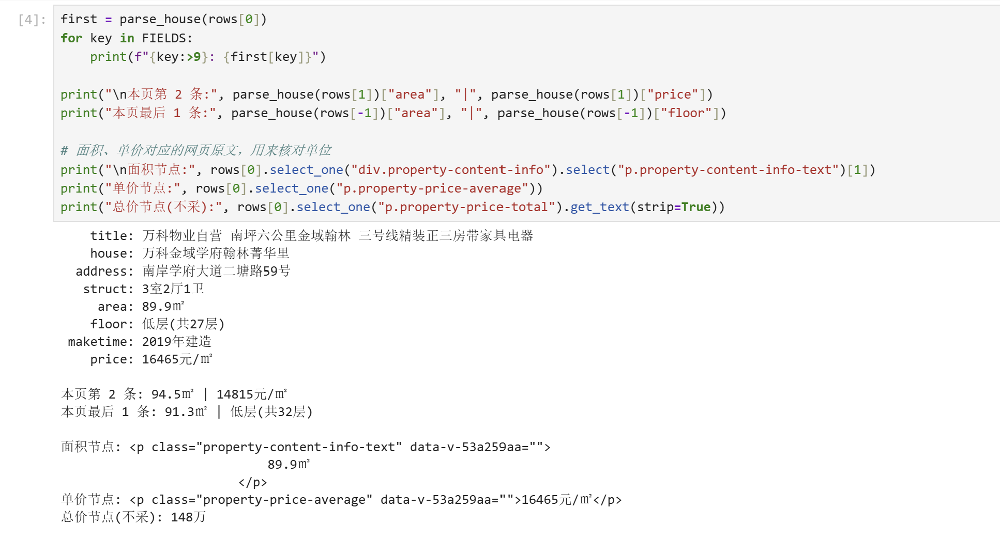

说明：两个选择方法各用在哪里？怎样确认面积和单价没有取错？

答：`select()` 用在「按容器批量取」的场景：`soup.select("div.property")` 一次取出当前页 60 条房源，返回列表，每一项是一条房源。`select_one()` 用在「单条房源内部找一个字段」的场景：`row.select_one("h3.property-content-title-name")`、`row.select_one("p.property-price-average")` 等，返回第一个匹配节点，找不到时返回 `None`，正好可以用 `if node else ""` 做缺失兜底。

面积和单价没有取错，是靠「先打印节点原文、再和网页对照」确认的。属性组 `div.property-content-info` 里有多个 `p.property-content-info-text`，其中第一个的 class 还带着 `property-content-info-attribute`，内容其实是户型「3室2厅1卫」——如果按 `p[0]` 取面积就会把户型当成面积。所以代码先排除带 `attribute` 的那个 `p`，剩下的才是面积、朝向、楼层、年代，`area` 取 `texts[0]`、`floor` 取 `texts[2]`（`texts[1]` 是朝向，不能当楼层）。单价用 `p.property-price-average` 取到 `16465元/㎡`，和网页一致；旁边的 `p.property-price-total` 是 `148万` 总价，明确不采。首条、第 2 条和本页最后一条都逐字段核对过，面积单位 ㎡ 和单价单位 元/㎡ 都保留。

建造年代不按下标取，而是遍历剩下的 `texts`，找包含「年建造」的那一项，找不到就保持空字符串，这样节点缺失或属性顺序变化都不会取错，也不会抛下标越界。

### 2. 下一页采集

- 下一页 `href` 原值：`?page=2`（节点为 `<a href="?page=2" class="next  next-active">下一页</a>`，注意 `get_text()` 得到的是「下一页」三个字，`get("href")` 才是地址）
- 用 `urljoin()` 补全后的地址：`http://www.bspider.top/anjuke/?page=2`
- 实际停止原因（明确禁用的末页按钮 / 异常中止）：第 10 页采集完成后，「下一页」按钮已禁用（`class=next`、`href=#`，不再带 `next-active`），判定正常结束

**截图：** 框出提取 `href`、补全地址、循环更新地址和停止条件的代码。附前两页的运行日志，以及最终停止提示。离线实验展示快照中的href、补全结果和文件读取记录，注明“离线回放”，不算在线翻页成功。

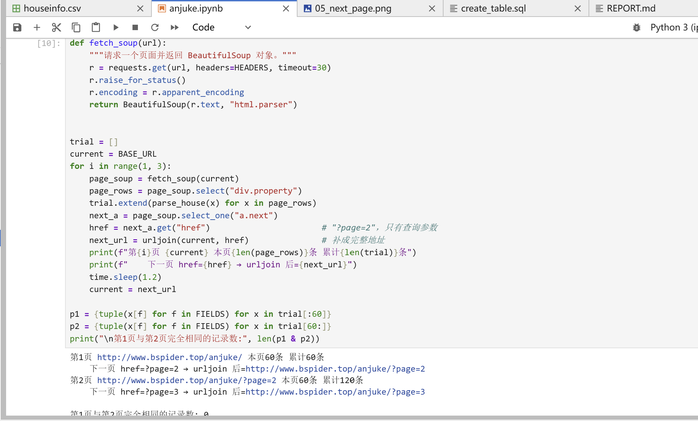

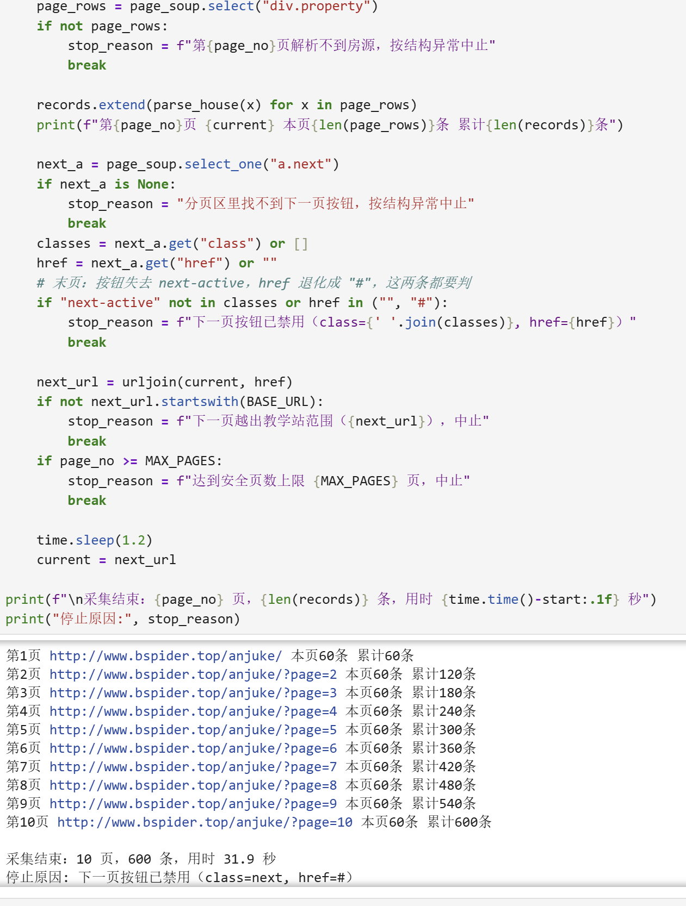

说明：怎样进入下一页？怎样防止重复采集或无限循环？若中途失败，说明停在哪一步。

答：每页解析完，用 `select_one("a.next")` 取到下一页节点，`get("href")` 拿到 `?page=2` 这样的相对地址，再用 `urljoin(current, href)` 基于当前页地址补全成完整 URL，最后把 `current` 换成新地址进入下一页。先试采 2 页，用 8 个字段组成的 tuple 做集合交集，第 1 页与第 2 页完全相同的记录数为 0，确认没有重复后才跑完整循环。

防重复和防死循环有三道：`visited` 集合记录访问过的地址，循环开头先判断 `current in visited`，重复就中止并记录原因；校验补全后的地址必须以教学站 `BASE_URL` 开头，越出站点就中止；`MAX_PAGES = 30` 作为安全上限，达到上限只能记为中止，不能算采集完成。停止条件是精确的「分页区存在、按钮存在、但 class 不含 `next-active` 或 href 退化成 `#`」；如果整个分页区或按钮找不到，则记为结构异常，也不算完成。

本次 10 页全部成功，每页 60 条、累计 600 条，没有中途失败。

### 3. 保存 CSV

**截图：** CSV保存与回读代码、回读条数。框出编码、表头和数据写入部分。

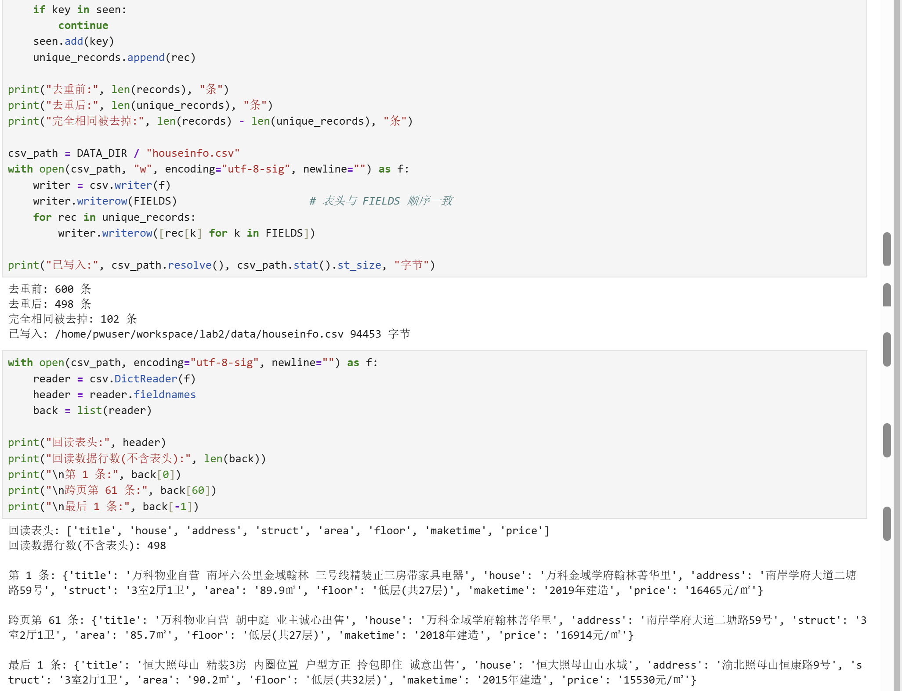

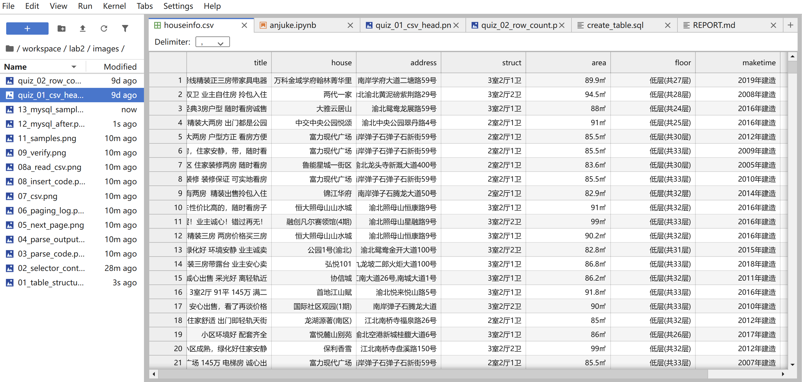

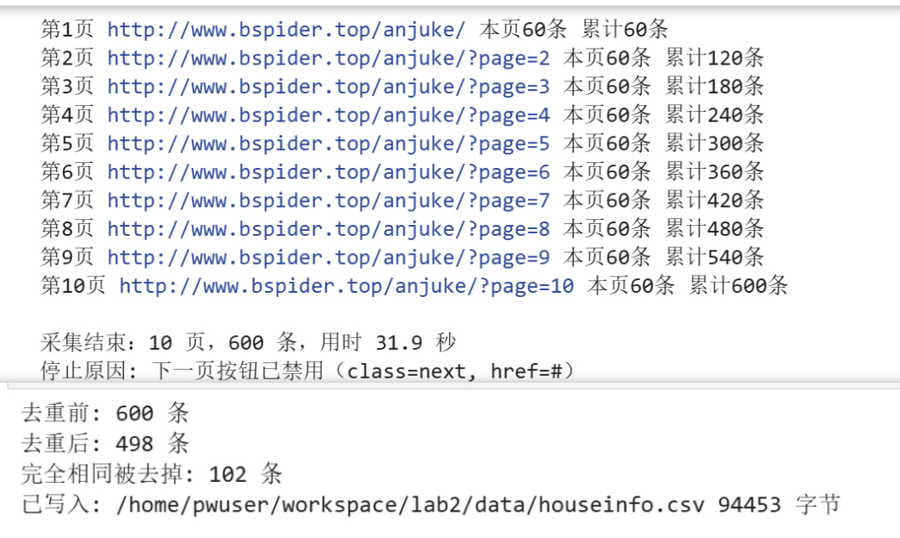

说明：8个字段的顺序是什么？按8个字段完全相同去重后，保存了多少条记录？

答：8 个字段的顺序固定为 `title → house → address → struct → area → floor → maketime → price`，``FIELDS`` 这个常量既用于 `csv.writer` 的表头，也用于每条记录 `writer.writerow([rec[k] for k in FIELDS])` 的取值顺序，保证 CSV 列序和解析顺序完全一致。

按 8 个字段组成 tuple 完全相同去重：去重前 600 条，去掉 102 条完全相同的记录，保存 498 条到 `data/houseinfo.csv`（94453 字节）。回读用 `csv.DictReader`，编码 `utf-8-sig`、`newline=""`，表头是 8 个字段名，数据行数（不含表头）为 498，和写入条数一致。

## 第三阶段：MySQL 数据存储

### 1. 读取 CSV 并入库

本阶段读取第二阶段的 `data/houseinfo.csv`，不重新采集。

**截图：** 框出读取CSV、按8个字段整理入库参数的代码。

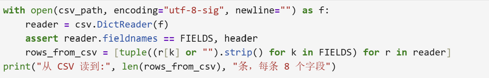

**截图：** 自己编写的入库代码。框出 `executemany()`、`commit()`、`rollback()`，以及关闭游标和连接的操作。另框出避免重复插入的代码。

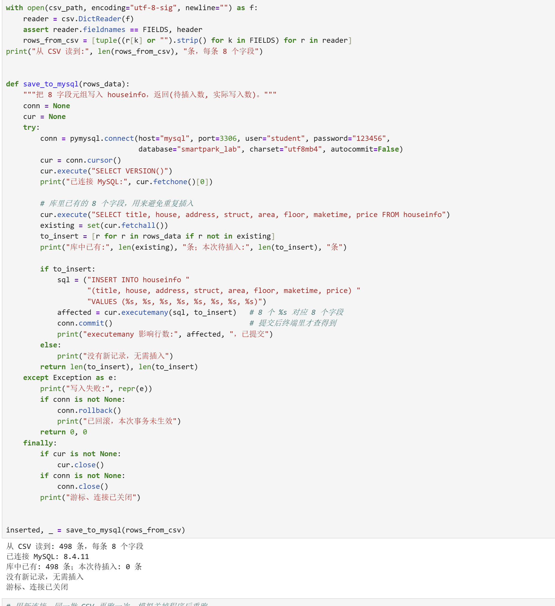

说明：每条记录怎样对应8个参数？成功、失败时分别做什么？再次运行时怎样避免重复插入？

答：`csv.DictReader` 读出的每一行是一个字典，用 `[(r[k] or "").strip() for k in FIELDS]` 按固定顺序压成一个 8 元组，`rows_from_csv` 就是 498 个 8 元组的列表。INSERT 语句写成 `(title, house, address, struct, area, floor, maketime, price) VALUES (%s, %s, %s, %s, %s, %s, %s, %s)`，列名顺序、占位符个数、每个元组的元素顺序三者一一对应，`executemany(sql, rows)` 时第 n 个 `%s` 就取元组第 n 个值，参数由 PyMySQL 转义，没有用 f-string 拼 SQL。

成功时 `cur.executemany()` 返回受影响行数 498，随后 `conn.commit()`，提交后另开的 MySQL 客户端才查得到这 498 条。失败时走 `except`，先判断 `if conn is not None` 再 `conn.rollback()`，撤销本次事务中尚未提交的写入。无论成功失败都在 `finally` 里先 `cur.close()` 再 `conn.close()`，并且每步都先判断对象是否创建成功。

避免重复插入没有清空表：入库前先 `SELECT title, house, address, struct, area, floor, maketime, price FROM houseinfo` 把库内已有记录取成集合，待插入列表只保留不在集合中的记录。首次运行时库中已有 0 条、待插入 498 条；同一批数据再跑一次时库中已有 498 条、待插入 0 条，程序直接提示「没有新记录，无需插入」，因此自增 id 不会因为重跑而继续膨胀。（本机截图是在数据已经入库之后补拍的，所以 `08_insert_code.png` 的输出已经是「库中已有 498 条，待插入 0 条」，正好就是重跑的那一次。）

### 2. 核对结果

#### 查询条数和样本

**截图：** MySQL 终端中的入库前后 `SELECT COUNT(*)`、重跑后的条数，以及 `SELECT ... LIMIT 5` 的结果。

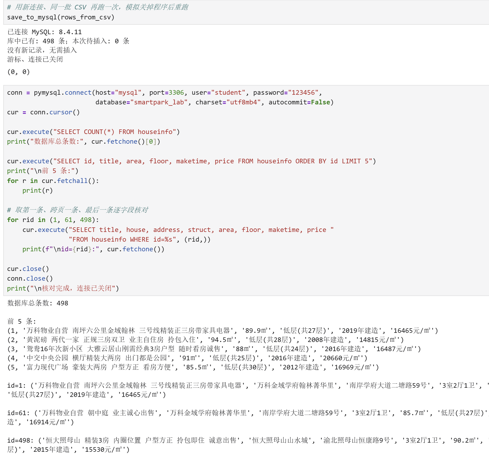

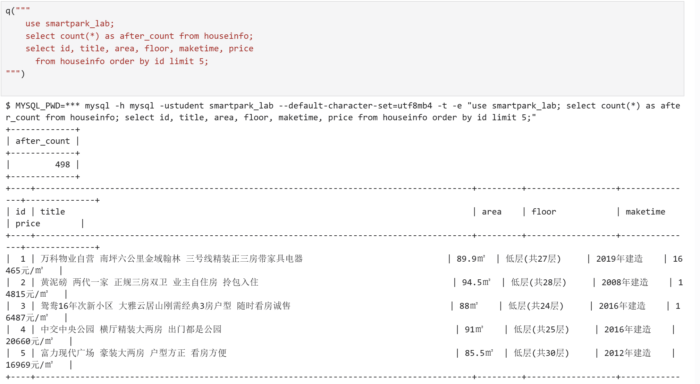

| 项目 | 实际结果 |
|---|---|
| 成功采集页数 | 10 页（每页 60 条） |
| 采集记录数（去重前） | 600 |
| 完全相同的重复记录数 | 102 |
| CSV数据行数（不含表头） | 498 |
| 入库前条数 | 0 |
| 入库后条数 / 本次新增条数 | 498 / 498 |
| 关闭上次程序后，同批数据独立重跑的条数 / 新增条数 | 498 / 0 |
| 单次采集用时 | 约 30～37 秒（每次网络状况不同，以运行输出为准） |
| 是否采集完整；未完成的原因 | 完整。第 10 页后「下一页」按钮已禁用（class=next、href=#），按手册规则判定为正常结束，未达到页数上限 |

说明：首次入库后的条数应等于去重后的CSV数据行数，8个字段的内容也应一致。若不一致，说明原因。总条数以实际结果为准。

答：首次入库后 `SELECT COUNT(*)` 为 498，等于去重后 CSV 的数据行数 498，说明 498 条全部写入成功、没有丢记录也没有多插。重跑同一批数据后条数仍是 498、新增 0 条，说明按 8 个字段比对去重是有效的。总条数以实际查询结果 498 为准，没有追求旧报告里的 601 条。

#### 逐条核对

选取第一条、跨页一条和最后一条，比较网页、CSV与数据库中的8个字段。快照实验对照教师提供的网页文件。

**截图：** 三条样本的对照结果，框出面积、单价和年代。可分图。

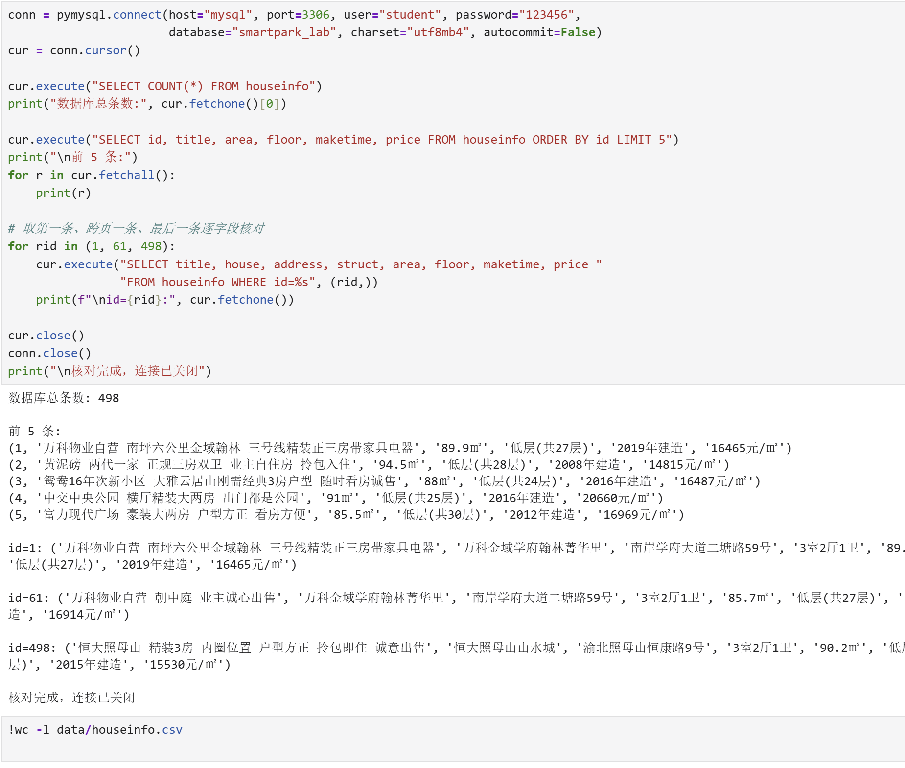

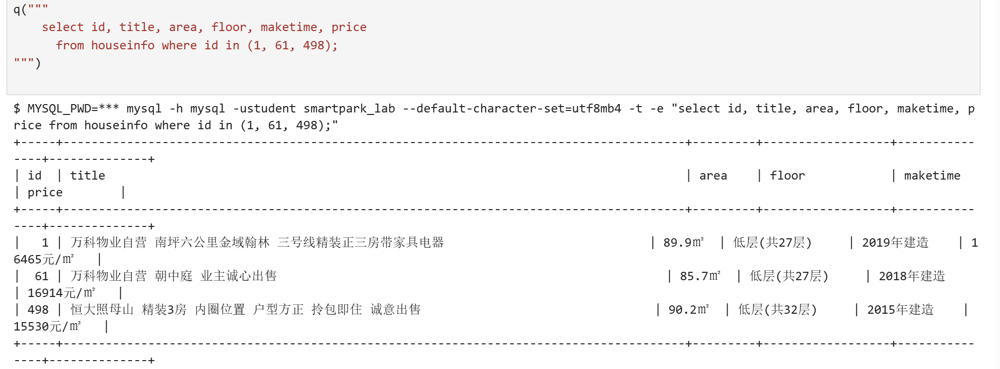

- 样本1（页码或URL、记录位置）：第 1 页 http://www.bspider.top/anjuke/ 第 1 条，`id=1`，标题「万科物业自营 南坪六公里金域翰林 三号线精装正三房带家具电器」
- 样本2（页码或URL、记录位置）：第 2 页 http://www.bspider.top/anjuke/?page=2 第 1 条，即全量第 61 条，`id=61`，标题「万科物业自营 朝中庭 业主诚心出售」
- 样本3（页码或URL、记录位置）：第 10 页 http://www.bspider.top/anjuke/?page=10 最后 1 条，即全量第 600 条、去重后第 498 条，`id=498`，标题「恒大照母山 精装3房 内圈位置 户型方正 拎包即住 诚意出售」

核对结论及差异：三条样本的 8 个字段在 CSV（回读单元输出）和数据库（`WHERE id IN (1,61,498)`）中完全一致，没有差异。网页这一侧没有单独截整页对照图，依据是第 4 单元打印的面积/单价 HTML 原文（`p.property-content-info-text` 为 `89.9㎡`、`p.property-price-average` 为 `16465元/㎡`）与 `id=1` 的三处取值相同，另外第 2 条和本页最后 1 条也逐字段核对过。

| 样本 | 面积 | 单价 | 年代 | 楼层 |
|---|---|---|---|---|
| id=1 | 89.9㎡ | 16465元/㎡ | 2019年建造 | 低层(共27层) |
| id=61 | 85.7㎡ | 16914元/㎡ | 2018年建造 | 低层(共27层) |
| id=498 | 90.2㎡ | 15530元/㎡ | 2015年建造 | 低层(共32层) |

样本 1 是第 1 页的第一条，能同时验证标题、地址（南岸学府大道二塘路59号，由多段 span 拼成）和户型（3室2厅1卫，不是被误当成面积的 `p[0]`）都取对了。样本 2 是跨页记录，验证分页后第 2 页的数据没有错位、也没有和第 1 页重复。样本 3 是最后一条，验证最后一页没有漏采，`price` 仍是每平方米单价而不是总价。

## 问题与解决

- 遇到的问题、处理方法及结果（没有可写“无”）：
  1. `mysql:8.4.11` 镜像从 Docker Hub 拉取失败（连接被重置）。改用国内镜像源拉取同一版本的镜像，再 `docker tag` 成课程要求的 `mysql:8.4.11`，`l05-mysql.ps1` 的镜像 ID 校验通过，MySQL 正常启动且状态 healthy。
  2. L05 更新包启用新的教学数据卷后，旧卷里建的表不在新卷中，查询报 `Table 'smartpark_lab.houseinfo' doesn't exist`。按手册要求不删除数据卷、不改密码，而是在新卷上用 `create_table.sql` 重新执行建表语句，之后再入库。
  3. 在本机浏览器里打开 JupyterLab 的终端面板时，面板一直空白，终端命令无法在浏览器终端里截图。改为在工作区的 Notebook 单元里直接调用工作区自带的 `mysql` 客户端（`-t` 表格输出、`utf8mb4` 编码），执行的是与 `mysql-console.bat` 相同的 SQL，截图见 `01_table_structure.png`、`12_mysql_after.png`、`13_mysql_samples.png`。为了让这条命令在源码里也有出处、不用一行行手敲，我把命令封装成辅助函数 `q(sql)` 放在 Notebook 末尾的「十、MySQL 终端取证」一节，由它拼出命令并用 `get_ipython().system()` 真正执行；这条命令等价于在 `mysql>` 提示符里逐条执行，属于同一套证据。
  4. 一开始 `q()` 是 `return` 一个以 `!` 开头的字符串，再用 `print(q(...))` 打印，结果只显示了一行命令、没有表格。原因是 `!` 魔法命令只在单元格里直接出现时才执行，放进字符串就只是文本。改用 `get_ipython().system(cmd)` 后，表格输出正常打到单元格里，同时在回显命令时把密码替换成 `***`。
  5. 属性组里 `p[0]` 的 class 同时带 `property-content-info-attribute`，实际是户型「3室2厅1卫」，如果直接按 `p[0]` 取会把户型当成面积。解决办法是先排除带 `attribute` 的 `p`，再取 `texts[0]` 作面积、`texts[2]` 作楼层，并打印原文核对。
- 尚未解决的问题、未完成的步骤（没有可写“无”）：
  - 无。源码、CSV、报告与截图均已放入仓库 `lab02/`，GitHub 上可直接打开报告并看到图片。

## 思考题

1. 本次怎样实现下一页采集？结合自己的代码说明。

   答：先用 `next_a = page_soup.select_one("a.next")` 定位分页区里的「下一页」按钮，`href = next_a.get("href")` 只取地址（`get_text()` 取到的是「下一页」三个字，不能用），本例是 `?page=2`。因为这是相对地址，用 `next_url = urljoin(current, href)` 基于当前页补全成 `http://www.bspider.top/anjuke/?page=2`。循环里依次做四件事：判断 `current` 是否已在 `visited` 集合中（防打转）、解析本页并 `records.extend(...)`、校验 `next_url` 仍在教学站范围内、`time.sleep(1.2)` 后 `current = next_url`。停止条件是：`next_a is None`（分页区/按钮消失，记为结构异常）、`"next-active" not in classes` 或 `href == "#"`（末页按钮被禁用，正常结束）、地址重复、越出站点、或达到 `MAX_PAGES=30` 上限。本次在第 10 页命中「按钮已禁用」，停止原因为 `下一页按钮已禁用（class=next, href=#）`。

2. 旧代码把 out_list 定义在全局。你把结果列表放在哪里？为什么？

   答：结果列表 `records` 在采集单元里就地新建，只在该单元内部使用，不作为全局变量；需要复用的常量（`BASE_URL`、`FIELDS`、`DATA_DIR`）才放在单元顶部当模块级变量。这样做的原因有两个：一是避免上一次运行的残留数据污染本次结果，重跑时不会出现条数越跑越多；二是避免不同单元、不同函数共享同一个列表造成的隐式耦合——写入数据库的函数 `save_to_mysql(rows)` 只接收传进去的 `rows_from_csv`，不读全局列表。试采 2 页时我也用了独立的 `trial = []`，正是靠局部变量把「试验数据」和「正式数据」隔离开，所以第 1、2 页的重复核对不会污染最终 600 条。

3. 你怎样获取建造年代？节点缺失或顺序改变时，怎样处理？

   答：建造年代没有用固定下标取。属性组里排除户型后剩下的 `texts` 依次是面积、朝向、楼层、年代，顺序一旦变化，按下标取就会错。所以代码遍历 `texts`，用 `if "年建造" in text` 判断，命中就赋值给 `maketime` 并 `break`，这样即使前面多了一项或顺序调整，只要文字里带「年建造」就能取到。节点缺失时（属性组 `div.property-content-info` 不存在，或没有匹配文字），`maketime` 保持空字符串 `""`，写进 CSV 和 MySQL 也是空字符串，不会报错。同理，`area` 和 `floor` 虽然用了下标，但都先判断长度（`len(texts) > 0` / `len(texts) > 2`），长度不够就填空字符串，避免 `IndexError`。

## 提交检查

- [x] 实验一原仓库的 `lab02/` 中已有源码、CSV、报告和真实截图。
- [x] 截图清楚，关键代码已框出，每项附有个人解释。
- [x] GitHub上能打开文件和图片，未上传个人账号密码、`.env`或教师答案。
- [x] 未完成项已如实说明；学习通只交原仓库链接。

如使用 AI，简述它帮助了什么，以及自己修改、运行和核对了什么：

本次使用 AI 助手协助排查环境（Docker 镜像拉取、L05 数据卷建表）、整理采集与入库代码的写法、讨论 `q()` 辅助函数怎样在单元格里真正执行 `mysql` 客户端。报告中的页数、条数、面积、单价、年代等数字全部取自实际运行输出（Notebook 单元格输出、mysql 客户端的 `-t` 表格），没有填写任何预设或期望值；所有截图都是我在自己的环境里实际运行后截取并自行框选的，未伪造数据。我也逐条读过 AI 给出的解释并对照自己的代码核对，不认可的表述已经改掉。
