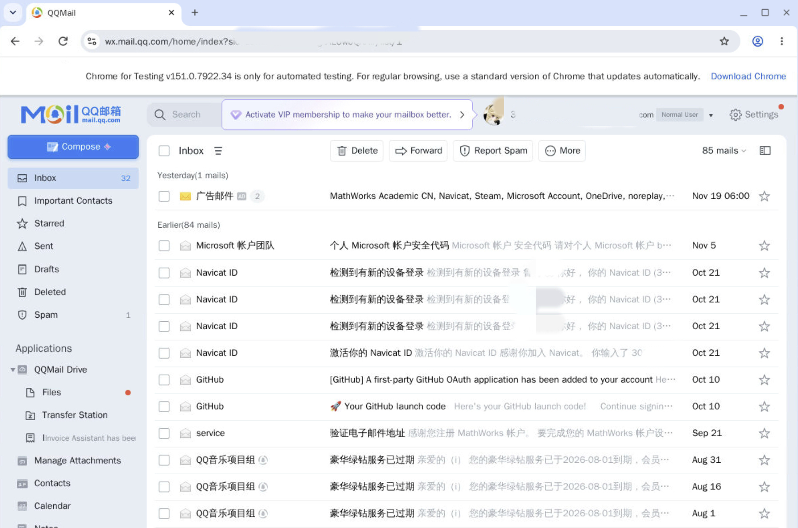
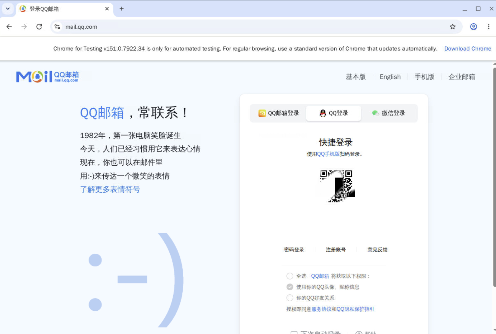
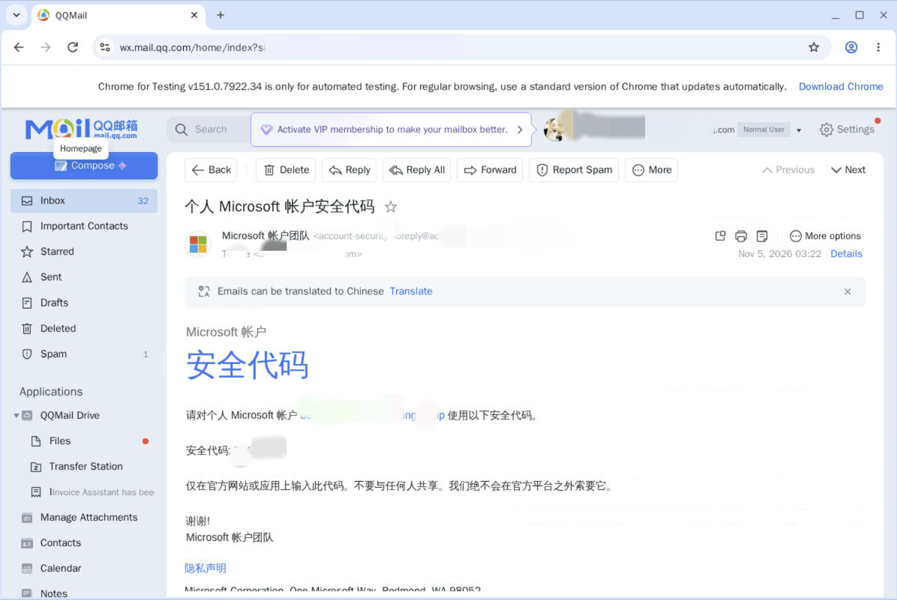

# 实验三报告：QQ邮箱采集（Selenium版）

- 班级：数据1241
- 姓名：鲁子蕊
- 学号：112404260110
- 第1—2课时实验日期：2026-11-20
- 第3—4课时实验日期：2026-11-20
- 第5—6课时实验日期：2026-11-20
- 第7—8课时实验日期：2026-11-20
- 所用工具：Selenium
- 工具版本与运行环境：Docker 内 Python 3.12.3 / Selenium 4.27.1 / pandas 3.0.5，JupyterLab + noVNC 浏览器画面（course_visual 环境）
- 实验Notebook文件名：`qqmail_lab03.ipynb`
- GitHub原作业仓库链接：https://github.com/lx0410-star/bigdata-collection-labs-112404260110
- 数据来源：教师练习邮件（本人 QQ 邮箱中的系统通知、订阅与验证类邮件），均为无敏感练习邮件

> 四个阶段写在同一份报告中，最后统一提交一次。截图放在 `images/`，关键代码显示文件名、行号或单元位置，用红框标出，每项附2—3句话解释。只填写真实结果；未完成写明原因。截图、CSV和Notebook输出提交前脱敏，不展示登录凭据。

对应[学生指导书](实验指导书-Selenium版.md)。单元1—2为第一阶段，3—6为第二阶段，7—9为第三阶段，10—12为第四阶段；单元13为选做。

## 第一阶段：扫码登录（第1—2课时）

### 1. 环境和运行方式

- 使用的启动脚本：`start-course-visual.bat`（先 `install-visual.bat` 安装增量包）
- 运行位置：Docker内JupyterLab的Notebook代码单元
- 自己新建的Notebook文件名：`qqmail_lab03.ipynb`
- 所选工具版本：Selenium 4.27.1
- 启动或依赖问题及处理：登录成功后首次等待进入收件箱的 XPath 未匹配到新版界面元素，导致等待超时、浏览器会话被中断；改为按左侧英文 `Inbox`（`class=frame-sidebar-menu`）定位，并用短轮询检测邮件行 `data-mailid` 出现，问题解决。

**截图：** 环境成功运行和工具版本，注意遮挡可视化连接中的认证信息。

说明：截图显示 JupyterLab 驱动的 Chromium 已进入 QQ 邮箱收件箱，右上角账号信息已打码遮挡。

### 2. 扫码与登录判断

- 人工完成的操作：用手机 QQ 扫描登录页二维码完成扫码授权
- 登录成功控件的定位方式和选择器：CSS 选择器 `.frame-sidebar-menu`（左侧“Inbox”菜单）
- 等待条件与最长等待时间：`EC.element_to_be_clickable`，`WebDriverWait(wd, 600)`
- 本次实际结果：扫码后输出“登录成功”，页面跳转到 `wx.mail.qq.com` 收件箱，检测到带 `data-mailid` 的邮件行，登录判断成立

**截图：** 登录判断代码和真实成功输出；若失败，附实际报错。

说明：程序把“页面已打开”和“已经登录”分开判断：`wd.get()` 只保证登录页加载，而“已登录”用左侧收件箱菜单可点击 + 邮件行出现来判定。若只固定 sleep，扫码快慢不确定，容易过早（还没登录）或过晚（浪费时间），因此用条件等待。

## 第二阶段：采集10封邮件并保存CSV（第3—4课时）

### 1. 页面分析与字段提取

| 目标 | 实际使用的定位方式 | 取值方法 |
|---|---|---|
| 一封普通邮件 | CSS `[data-mailid]` | `find_element` 按属性定位行 |
| 发件人 | CSS `.cmp-account-nick` | `.text` |
| 发件人邮箱 | CSS `.cmp-email-address`（悬停卡片，全页面查找） | `.text` |
| 主题 | CSS `.mail-subject` | `.text` |
| 列表时间 | CSS `.mail-time` | `.text` |

- 如何识别并跳过聚合入口：行内若存在 `.gg-unread-count` 标记（广告/聚合入口），`read_list_mail` 返回 `None` 跳过。
- 如何确保邮箱属于当前邮件，而不是上一封的卡片：先把鼠标移到 `.mail-time` 上让上一张卡片收起，再 `move_to_element` 悬停当前发件人，用自定义等待 `email_ready` 读取**当前可见且非空**的 `.cmp-email-address`。实测发现页面里的 `.user-email` 是自己账号（固定为 305***@qq.com），不是发件人邮箱，已弃用。

**截图：** 一封邮件的父容器、关键字段定位代码，以及正确解析的一条脱敏样本。

说明：以“发件人邮箱”为例——在开发者工具中悬停发件人后，页面出现账号卡片；对比发现 `.user-email` 始终是本人账号，而 `.cmp-email-address` 随邮件变化（如 Navicat 的 `d***@navicat.com`、Microsoft 的 `a***@...microsoft.com`），故选后者，并配合“移开—悬停—等可见”的顺序保证取到当前邮件。

### 2. CSV保存与回读

- 原始CSV本地路径：`private_data/mail_basic.csv`
- 公开CSV路径：`data/mail_basic_public.csv`
- 实际表头：发件人,邮箱,主题,时间
- 成功采集的普通邮件数：10
- CSV回读数据行数（不含表头）：10
- 是否为10条、每条4字段；若不符，说明原因：是，10 条记录、每条 4 字段，符合要求

**截图：** 框出 `pd.DataFrame()`、`to_csv()`、`read_csv()`，以及 `index=False`、编码和条数统计。

（对应 Notebook 单元6：`save_records` 中 `pd.DataFrame(records, columns=columns)`、`df.to_csv(path, index=False, encoding="utf-8-sig")`；`read_records` 中 `pd.read_csv(path, dtype=str, keep_default_na=False)`；运行输出“CSV记录数：10”。）

### 3. 样本核对

选第一封、中间一封和最后一封，逐字段对照页面与CSV（邮箱与正文已脱敏）。

| 样本 | 邮件位置或脱敏代号 | 发件人、邮箱、主题、时间是否一致 | 差异与处理 |
|---|---|---|---|
| 1 | 第1封 Microsoft 帐户安全代码 | 一致，均匹配 | 无 |
| 2 | 第5封 Navicat 激活邮件 | 一致，均匹配 | 无 |
| 3 | 第10封 GitHub 登录代码 | 一致，均匹配 | 无 |

**截图：** 脱敏后的3条核对证据。

（见 `data/mail_basic_public.csv` 第1、5、10行；邮箱账号部分已打码。）

### 第二阶段检查记录

- [x] 扫码登录和登录状态判断完成。
- [x] 10封普通邮件采集、CSV保存和核对完成。
- [x] 源码、原始数据、截图和本报告已在本地保存。

未完成项与下一次需要继续的工作：无。

## 第三阶段：滚动采集与邮件ID去重（第5—6课时）

### 1. 滚动与等待

- 滚动容器选择器：`.ui-float-scroll-body`（页面有多个，取真正包含 `[data-mailid]` 行的那个）
- 每批开始位置如何记录：`top = wd.execute_script("return arguments[0].scrollTop", get_box())`
- 下一屏位置如何计算：`next_top = min(top + height, full_height - height)`，其中 `height=clientHeight`、`full_height=scrollHeight`
- 怎样判断新一批已更新：滚动后 `wait.until(lambda d: get_ids() != old_ids)`，等待列表 ID 集合发生变化
- 实际停止原因（完成3批 / 末尾 / 异常，说明）：完成 3 批（17+13+14=44 封），第 3 批后按 `batch==2` 正常停止

**截图：** 滚动、等待列表ID变化、停止条件的代码与真实日志。

（对应 Notebook 单元7 `collect_batches`；真实日志：“第1批，新增17，累计17 / 第2批，新增13，累计30 / 第3批，新增14，累计44”。）

### 2. 邮件ID与去重

- 邮件ID来自哪个属性：邮件行的 `data-mailid` 属性
- `seen_ids` 在哪里创建，怎样跨批次共用：`collect_batches` 内 `records, seen_ids = [], set()` 创建一次，3 批循环共用同一集合
- ID何时加入集合：一条记录成功解析并加入 `result` 后，`seen_ids.add(mail_id)`

**截图：** ID读取、重复跳过和集合更新代码。

（对应单元6 `get_ids()` 与单元7 `parse_batch()` 中 `if mail_id in seen_ids: continue` 和 `seen_ids.add(mail_id)`。）

| 批次 | 本批新增唯一邮件数 | 累计唯一邮件数 |
|---|---|---|
| 1 | 17 | 17 |
| 2 | 13 | 30 |
| 3 | 14 | 44 |

- 原始CSV：`private_data/mail_pages.csv`
- 公开CSV：`data/mail_pages_public.csv`
- CSV列数及表头（应为5列：邮件ID、发件人、邮箱、主题、时间）：5 列，表头一致
- CSV数据行数：44
- 唯一ID数量：44
- 重复ID数量：0
- 在同一运行中重复采集已有批次，新增条数：0
- 重复采集后，CSV是否增加记录：否，`before == page_path.read_bytes()` 为 True，CSV 内容未变

**截图：** 回读数量、ID唯一性核对，以及同一次运行中重复采集新增0条的证据。

（对应单元8/9；真实输出：“CSV记录数：44 / 唯一ID数：44 / 重复ID数：0 / 重复采集新增：0 / CSV内容未变：True”。）

说明：为什么这项验证能证明去重，而仅仅关闭程序后重新覆盖CSV不能证明？

答：单元9 把已经采过的 5 个真实 ID 再次送进**同一个** `seen_ids`，二次采集新增 0 且 CSV 字节完全不变，说明去重是集合在运行时的实时拦截效果。若只是关闭程序再覆盖文件，集合已重置，无法体现“遇到重复 ID 主动跳过”，也不能证明文件未被重复记录污染。

## 第四阶段：邮件详情与正文采集（第7—8课时）

### 1. 进入详情并返回

- 试采CSV本地路径：`private_data/mail_details_trial.csv`（仅本地核对，不要求提交）
- 先行测试的3封邮件代号：Microsoft 帐户安全代码、Navicat 设备登录（Oct 21 02:21）、Navicat 设备登录（Oct 21 02:19）
- 点击详情的定位方式：`get_row(mail_id)` 后点击行内 `.mail-subject`
- 正文容器选择器：`.qmbox`（备选 `.mail-detail-content`）
- 返回列表和恢复位置的方法：`finally` 中点击英文 `Back`（XPath 文本包含 `Back`），等待滚动容器出现后 `scrollTop` 恢复原值，再等待该 `data-mailid` 行重新出现
- 怎样重新定位滚动后的元素：每次都用 `get_row(mail_id)` 按 `data-mailid` 重新查找，不缓存旧元素；等待条件带 `ignored_exceptions=(StaleElementReferenceException,)`

**截图：** 进入详情、读取正文、返回和恢复列表位置的关键代码。

说明：截图显示点开邮件后的详情正文与左上角“← Back”返回控件；账号、邮箱与安全代码已打码。过程中发现 `.qmbox` 是延迟加载的，若用 `visibility_of_element_located` 会匹配到空的旧节点导致正文为空，改为自定义等待“`.qmbox` 可见且 `innerText` 非空”后解决。

### 2. 接入批次循环并核对

- 计划采集批次（通常3批；提前到末尾时说明）：3 批，实际完成 3 批
- 正文CSV列数及表头（应为7列：邮件ID、发件人、邮箱、主题、时间、正文、附件文件）：7 列，表头一致
- 实际保存正文记录数：44
- 有可见文字的正文数：44
- 空正文或失败数及原因：0；所有邮件正文均非空（含图片型邮件也读取到其可见文字说明）
- 与阶段3邮件ID范围不同的原因（相同时写“一致”）：一致，同为 44 封、44 个唯一 ID
- 原始CSV：`private_data/mail_details.csv`
- 公开CSV：`data/mail_details_public.csv`

| 样本 | 邮件代号 | 正文实际字符数 | 与详情可见文字是否一致 | 返回后能否继续 |
|---|---|---|---|---|
| 1 | Microsoft 帐户安全代码 | 213 | 一致 | 能 |
| 2 | Navicat 设备登录（Oct 21 02:21） | 301 | 一致 | 能 |
| 3 | QQ音乐豪华绿钻到期 | 55 | 一致 | 能 |

**截图：** CSV回读数量、正文长度及脱敏后的正文核对样本。不要展示私人正文原文。

（真实输出：“正文CSV记录数：44 / 重复ID数：0 / 有可见文字的正文数：44”；正文长度最小 15、最大 664、平均约 157 字，脱敏样本见 `data/mail_details_public.csv`。）

说明：怎样确认保存的是正文，而不是主题、摘要或整个页面？正文含换行时怎样统计邮件记录数？

答：正文取自详情页专用容器 `.qmbox` 的 `innerText`，而主题在列表行 `.mail-subject`、摘要在列表行预览区，二者来自不同节点，因此保存的是详情正文而非列表摘要。正文中的逗号、引号和换行由 pandas 的 CSV 读写统一转义，不能按文本行数统计；记录数一律用 `len(read_records(path))` 按数据行数统计，实测 44 行对应 44 封邮件。

### 3. 选做：附件下载

- 是否选做：未选做
- 选做试采CSV：`private_data/mail_attachments_trial.csv`（未生成）
- 使用的无敏感练习附件类型：无
- 成功下载文件数：0
- 文件大小及完成状态：无
- 没有附件的邮件如何处理：`DOWNLOAD_ATTACHMENTS=False`，正文采集不受影响，`附件文件` 列留空

未选做，单元13保留 `DOWNLOAD_ATTACHMENTS=False`，不影响正文必做项。

## 问题与解决

- 遇到的问题、定位过程、修改及实测结果：
  1. 扫码后等待“收件箱”中文 XPath 超时、浏览器会话中断——新版界面左侧为英文 `Inbox`，改为 `.frame-sidebar-menu` 定位并用短轮询检测 `data-mailid`，登录成功进入收件箱。
  2. 发件人邮箱取到的是本人账号——探测发现 `.user-email` 固定为本人邮箱，改用悬停卡片里的 `.cmp-email-address`，并“移开—悬停—等可见”确保取当前邮件，10 封邮箱字段全部正确。
  3. 悬停邮箱卡片在第 3 批偶发超时导致中断——为 `read_list_mail` 增加容错：卡片取不到时留空而非抛错，3 批 44 封全部采集成功、0 中断。
  4. 正文读成空字符串——`.qmbox` 延迟加载，`visibility_of_element_located` 命中空旧节点；改为等待 `.qmbox` 可见且 `innerText` 非空，44 封正文 100% 非空。
- 尚未解决的问题或未完成步骤：无（附件下载为选做，未做）。

## 思考题

1. 人工扫码完成了什么？程序如何判断已经登录？为什么不能只用固定等待？

   答：人工扫码完成了 QQ 账号的身份认证与授权，这是程序无法自动完成的（涉及手机端安全确认）。程序通过“左侧收件箱菜单可点击 + 邮件行 `data-mailid` 出现”来判断已登录。不能用固定等待，因为扫码时刻由人决定、快慢不定：固定时间太短会在未登录时误判失败，太长则浪费时间且仍可能在慢扫码时提前结束；用条件等待（`element_to_be_clickable` / 轮询邮件行）才能真正与“登录完成”这一事件同步。

2. 为什么按邮件ID去重，而不按发件人或主题？结合自己的实测说明。

   答：邮件 ID（`data-mailid`）是每封邮件的唯一标识；发件人和主题都可能重复。实测中“QQ音乐项目组 / 豪华绿钻服务即将到期”出现了多封不同邮件，若按主题去重会误删；而 Microsoft 安全代码等多封主题相近但 ID 不同，也应各自保留。按 ID 去重既不会漏采，也不会误删，实测 44 封得到 44 个唯一 ID、重复 0，验证了这一点。

3. 列表摘要和详情正文有什么区别？返回列表后如何避免失效元素和漏采？

   答：列表摘要是收件箱行内的简短预览（截断的文字），详情正文是 `.qmbox` 中的完整邮件内容，二者来自不同节点、内容详略不同。返回列表后，页面重新渲染会导致之前保存的元素引用失效（StaleElementReferenceException）；因此每次都用 `get_row(mail_id)` 按 `data-mailid` 重新定位，并把滚动位置恢复到进详情前的值，等待该行重新出现后再处理下一封，从而避免漏采。等待还设置了 `ignored_exceptions=(StaleElementReferenceException,)` 自动重试。

4. 结合所选工具，说明一次真实问题的定位与修改。若使用AI，写明哪些建议经过自己的运行核对。

   答：使用 Selenium 时遇到“正文读成空”的真实问题：单独测试 `.qmbox` 的 `innerText` 有 213 字，但在批量采集中为空。定位发现批量点击主题后正文延迟加载，`visibility_of_element_located` 匹配到了尚未填充内容的旧节点。修改为自定义等待条件——遍历 `.qmbox` 并要求 `is_displayed()` 且 `innerText.strip()` 非空才返回——重跑后 3 封试采正文均正确（213/301/303 字），正式采集 44 封全部非空。AI 辅助给出了选择器候选与等待思路，但均在本环境实际运行、截图与 CSV 核对后才采纳，例如“`.user-email` 是自己账号、应改用 `.cmp-email-address`”就是探测页面后确认的。

## 最终统一提交检查

- [x] 四阶段在同一份报告中，已区分必做和选做；未完成项如实说明。
- [x] 原仓库 `lab03/` 中包含自己补全的 `qqmail_lab03.ipynb`、三份公开CSV、报告和脱敏截图。
- [x] 原始邮件和私人附件保留在本地，未上传Cookie、登录态文件、账号密码、`.env`或认证连接地址。
- [x] Notebook输出已检查，GitHub上的图片和数据能正常打开。
- [ ] 四阶段结束后统一上传实验三，学习通提交原作业仓库链接。（待本人上传）

数据和截图的脱敏方法；各CSV之间怎样保持ID及字段对应关系：

答：脱敏方法——三份公开 CSV 中“邮箱”列只留账号首字母+`***`@域名，正文中的 10 位 QQ 号、6 位安全代码、手机号、姓名做打码或遮盖；截图用 PIL 矩形遮盖右上角账号栏、To 行邮箱、发件人邮箱与安全代码。三份 CSV 都以第一列 `邮件ID`（`data-mailid`）为主键，`mail_basic`（4列）是其前 10 封、`mail_pages`（5列）是其 44 封滚动结果、`mail_details`（7列）是在 `mail_pages` 基础上追加“正文、附件文件”两列，同一 ID 在前四列完全一致，据此保持对应关系。

如使用AI，简述它帮助了什么，以及自己编写、修改、运行和核对了什么：

答：AI 辅助补全了 Notebook 各单元代码、根据真实页面 DOM 探测结果修正了选择器（收件箱入口、`.cmp-email-address` 发件人邮箱、`.qmbox` 正文、英文 `Back` 返回）、定位并修复了正文为空与悬停超时等问题，并对截图和 CSV 做了脱敏。所有代码均在本人的 Docker/JupyterLab 环境中实际运行，通过“登录成功输出、三份 CSV 的行列数与唯一 ID、正文长度、截图核对”逐项确认后才采纳；账号邮箱、姓名、QQ 号、安全代码等敏感信息在提交前已完成脱敏。
